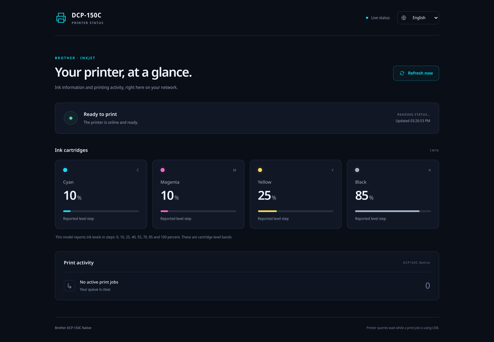

# Brother DCP-150C Native

Native Linux printing and a local printer dashboard for the **Brother DCP-150C on Raspberry Pi**.

**Native printing has been tested on real hardware.** A Pi Zero 2 W printed an A4 test page through the native CUPS queue at Normal quality on plain paper, with readable text and visible cyan, yellow and black fields. Magenta was absent from the printer's built-in quality check too; this issue occurs independently of the Pi print path.

This is a hardware-tested preview. Broader physical coverage remains open, so build information continues to report `production_ready: false`. See the [hardware validation results](#hardware-validation) for the tested settings and remaining limits. The dashboard can be installed independently.

The software includes:

- A portable C program that converts page pixels into DCP-150C printer commands, without running an x86 driver through an emulator.
- Integration with the Common UNIX Printing System (CUPS), including PDF/PostScript rendering, six quality settings and a separate printer queue.
- A small dashboard in German and English with printing activity, connection status and available ink information. It runs without Python package dependencies.
- A configuration tool with readable options and installation/removal scripts that preserve existing printer settings.



## Hardware validation

On **27 October 2026**, the native driver completed a real one-page print through CUPS on a **Raspberry Pi Zero 2 W**, connected to the DCP-150C over USB. The printed page was inspected in user-supplied photographs.

| Check | Observed result |
| --- | --- |
| A4, plain paper, Normal quality, one copy | Page physically printed and ejected; CUPS reported successful completion |
| Black text and alignment line | Readable text and a continuous line visible |
| Cyan, yellow and black test fields | Visible on the printed page |
| Magenta test field | Very faint and blue-tinted; the printer's independent built-in quality check also has no magenta pattern |
| Same test page converted by the native and original drivers | Byte-identical output: 498,444 bytes, using the same settings |
| Printer status and cartridge levels | Read directly from the connected printer; dashboard returns to ready after printing |
| Network printing access | Shared CUPS queue and local-network discovery verified |
| Other quality settings, paper materials, sizes and multiple-page jobs | Software comparisons cover these paths; broader physical testing remains open |

The built-in quality check runs without the Pi driver. Its missing magenta pattern establishes that the magenta issue also exists at the device. An empty cartridge, blocked nozzles or another ink-delivery issue has not yet been distinguished. Magenta output is therefore still outside the physically verified coverage.

Cartridge percentages are the original monitor's reported level bands. A nonzero reading does not establish that ink is reaching the paper. The [hardware validation summary](docs/hardware-validation.json) records this scope in a structured form.

## Get started on the Pi

The [prebuilt Pi packages](https://github.com/Fluffyattack/brother-dcp150c-native/releases) include static ARMv6 programs, their source code, required runtime data and installation scripts. Download and unpack a release to use the programs already in `build/`; compilation is optional.

Use Raspberry Pi OS with Python 3.10 or newer, systemd and CUPS 2.x:

```sh
sudo apt update
sudo apt install git build-essential python3 cups cups-client cups-filters ghostscript avahi-daemon
git clone https://github.com/Fluffyattack/brother-dcp150c-native.git
cd brother-dcp150c-native
make
```

`make` builds the native raster converter `build/bh7filter` and configuration tool `build/brprintconf_dcp150c` for the machine doing the build. Both 32-bit ARM and ARM64 use the same source code.

To install just the dashboard and monitor an existing queue:

```sh
lpstat -p
sudo scripts/install.sh --dashboard-only --queue YOUR_EXISTING_QUEUE
```

Open `http://<pi-address>:8080/`. For a quick run without installing a service:

```sh
python3 -m dcp150c --queue YOUR_EXISTING_QUEUE
```

Unavailable ink readings appear as unknown. Status requests wait while the printer connection is in use.

## Dashboard languages

The dashboard supports **English and German**. It automatically chooses the first supported language in the browser's language preferences, including regional variants such as `de-AT` and `en-GB`. Other languages fall back to English.

Use the language selector at the top of the page to choose a language. The browser remembers the choice for that dashboard address; select **Automatic / Automatisch** to follow the browser again. Switching language updates the displayed readings immediately without requesting another USB reading. If browser storage is disabled, the selector still works for the current page.

Translations cover status and error messages, cartridge states, print-job counts, screen-reader labels and the page title. Times and percentages follow the selected language's formatting. Printer display text, queue names and job identifiers retain their original content.

To add another language, copy an entry in [`dcp150c/static/translations.js`](dcp150c/static/translations.js), use its standard language tag as the key and translate the messages. Keep identifiers and `{parameter}` names unchanged. Set `direction` to `rtl` for a language written from right to left and add any needed plural categories such as `activity.active_jobs.few`; counts use the browser's language-specific plural rules. Missing messages fall back to English. No server dependency or build step is required. Reinstall the dashboard and restart its service to serve an updated catalogue.

The status API keeps its existing English `message` and `warnings` fields for compatibility. `message_code`, `message_parameters` and `warning_details` provide stable identifiers and parameters for translated clients.

## Install native printing

The A4/plain-paper/Normal path has passed its first physical test. The current release remains a preview while broader hardware coverage is collected. Approve the exact preview executable with:

```sh
sudo scripts/install.sh --allow-unverified-filter
```

Connect and switch on the printer first. The installer creates the separate queue `DCP150C-Native`; it preserves existing queues. An enabled older queue for the same USB printer must be paused before using the shared connection. The installer explains which queue needs attention and sends no test page itself.

After installation, submit a document with:

```sh
lp -d DCP150C-Native -o PrintQuality=Normal document.pdf
dcp150c-config --get
```

The converter accepts complete eight-bit RGB portable pixmap (P6) pages. CUPS uses Ghostscript to create these pages from documents. Quality determines the input resolution: Draft uses 150 dots per inch, Fast uses 300, and Normal/Fine/Photo/Highest use 600. The printer options enforce the supported combinations of quality and paper material.

See [installation, configuration and removal](packaging/README.md) for network sharing, explicit USB selection, alternative build locations and troubleshooting.

## Ink and printer status

The dashboard reads connection information and printing activity from Linux and CUPS. With the managed USB backend it also reads cartridge counters directly from the DCP-150C. This exchange has been verified on the connected printer without sending a print page.

Ink polling is enabled by default. It requires this project's shared USB backend and an idle printer. The printer needs nearly eight seconds to respond to each of the separate cartridge and device-status requests, so a complete reading usually takes about sixteen seconds. The HTTP dashboard stays responsive while its background worker waits.

Readings use the original monitor's level bands: **0, 10, 25, 40, 55, 70, 85 and 100 percent**. These are reported cartridge bands and do not measure ink delivery or nozzle condition. A missing response remains unknown. Set `DCP150C_MODEL_STATUS=0` to use basic connection and queue monitoring only.

Dashboard settings are kept in `/etc/dcp150c-native/dashboard.env`. Installation preserves that file. Details are in the [status configuration instructions](packaging/README.md#dashboard-only).

## Build for the original Pi Zero

On a Debian/Ubuntu Linux development host:

```sh
sudo apt install gcc-arm-linux-gnueabihf python3 make
make armv6
```

This produces static binaries in `build/armv6/`, including support for the ARM1176 processor in the original Pi Zero. The build uses checksum-verified musl 1.2.6 sources and the ARMv6 startup/arithmetic runtime from Raspbian GCC 12. Build dependencies remain inside the ignored `build/` directory.

The [automated build](.github/workflows/build.yml) executes these binaries with the ARM1176 CPU model and compares a complete color page with the host build. It also packages the programs with their source and runtime data. For installation on a Pi, select both matching tools with:

```sh
sudo scripts/install.sh --filter build/armv6/bh7filter --allow-unverified-filter
```

## Find your way around the code

| Location | Purpose |
| --- | --- |
| `src/filter.c`, `src/input.c` | Command-line options, printer settings and page dimensions |
| `src/pipeline.c` | Read pages and coordinate conversion in bounded chunks |
| `src/profile.c`, `src/calibration.c` | Load and select the printer's color calibration |
| `src/color.c`, `src/rows.c` | Convert RGB pixels into packed ink rows |
| `src/planes.c`, `src/codecs.c`, `src/device.c` | Arrange nozzles, compress rows and write printer commands |
| `src/printconfig.c` | Read and safely update configuration files |
| `data/`, `config/` | Required printer calibration, paper dimensions and defaults |
| `dcp150c/` | Status reader, HTTP server and dashboard |
| `packaging/`, `scripts/` | Print-service integration and installation |

`bh7filter` is the compatibility name of the raster converter. `Bh7` identifiers refer to this printer engine. External configuration names and protocol identifiers are retained for compatibility; project functions and messages describe their purpose.

## AI disclosure

This project was developed with substantial assistance from **Claude and OpenAI Codex**. Validation includes comparisons with the original driver, processor compatibility checks, dashboard tests and the physical A4 print described above. Physical coverage is limited to the documented settings and working color channels.

Only project source code, required runtime data, installation files and user documentation are published here.

## Related projects

- [brlaser](https://github.com/pdewacht/brlaser): an independent native driver for Brother laser printers.
- [brother-in-arms](https://github.com/alexivkin/brother-in-arms): ARM packaging for selected Brother laser models.

This project targets the DCP-150C inkjet engine. It is independent of Brother Industries.

## Licenses

Original project code is licensed under [GPL-2.0-or-later](LICENSE). Printer calibration data is distributed under the separate [Brother software license](data/BROTHER-LICENSE.txt). Static ARMv6 builds also include musl and GCC runtime code; their notices are in [LICENSES](LICENSES/). Keep all applicable notices with redistributed software.
