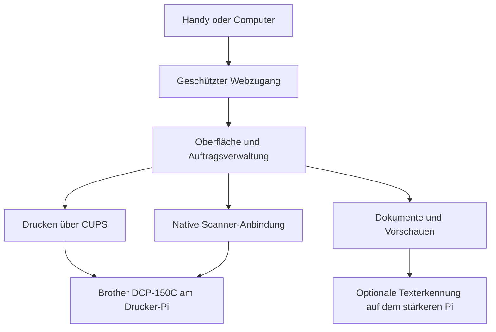

# Funktionsplan für das DCP-150C Control Center

Stand: 28. Oktober 2026. Status: Web- und Verarbeitungspfade implementiert; weitere Gerätetests offen.

Die Webbedienung, Dokumentverarbeitung und lokale Texterkennung sind implementiert. Den nutzbaren Ablauf beschreibt die [Bedienungsanleitung](control-center-usage.de.md), die Softwareprüfungen stehen im [Prüfbericht](control-center-validation.json). Die nachfolgenden Abnahmekriterien bleiben bestehen; eine implementierte Scanner-Anbindung ersetzt keinen bestätigten Scan am Gerät.

Das vorhandene Dashboard soll zu einer verständlichen Steuerzentrale für Drucken, Scannen, Dokumente und Gerätestatus werden. Es bleibt im Browser auf Handy und Computer bedienbar. Der native Druckertreiber bleibt dabei ein eigenständig installierbarer Bestandteil.

Die Umsetzung beginnt mit dem Abschluss der vorhandenen Drucksoftware. Danach folgen geschützte Bedienfunktionen und eine nachgewiesene Scanner-Anbindung. Neue Funktionen werden erst als verfügbar angezeigt, wenn ihr jeweiliger Verarbeitungspfad funktioniert.

## Vorbild und vorhandener Stand

Brother ControlCenter3 war die Windows-Steuerzentrale dieser Gerätegeneration. Die Modellanleitung beschreibt Scan-Ziele, eigene Scan-Profile, PhotoCapture, Kopieren und Geräteinformationen. Einige Bereiche gelten nur für andere Modelle: PC-FAX und bestimmte Fernkonfigurationen sind für den DCP-150C nicht vorgesehen. Die Anleitung zeigt eine klassische und eine moderne Oberfläche. [Brother Software-Handbuch, Kapitel 3, gedruckte Seiten 53 bis 77](https://download.brother.com/welcome/doc002231/cv_mfc235_ukeng_soft.pdf#page=58)

Für unser Projekt dienen die Funktionen als Vorbild. Die Bedienung und Gestaltung werden für den Browser entwickelt; Brother-Anwendung und Grafiken werden nicht mitgeliefert.

| Bestandteil | Vorhandener Stand |
| --- | --- |
| Nativer Druckertreiber | Vollständiger Konverter mit sechs Qualitätsstufen und Vergleichstests gegen den Originaltreiber |
| Physischer Druck | Eine A4-Seite auf Normalpapier in Normalqualität über den nativen Druckpfad bestätigt |
| Drucken im Netzwerk | Gemeinsame Warteschlange und Erkennung im lokalen Netzwerk eingerichtet |
| Gerätestatus und Tintenfüllstände | Direkte Abfrage des Druckers, gemeinsame USB-Sperre mit der Druckwarteschlange |
| Weboberfläche | Sieben Bereiche mit Anmeldung, Aufträgen, Deutsch und Englisch sowie gespeicherter Sprachwahl |
| Scanner auf dem Drucker-Pi | Natives Backend für das ältere Modellprotokoll gebaut und installiert; Decoder auf drei Builds verglichen; erste echte Aufnahme noch offen |
| Webaktionen und Dokumentablage | Geschützte Uploads, Vorschau, Bearbeitung, Zusammenführen, Drucken, Aufbewahrung und Profile implementiert |
| Texterkennung | Lokale neuronale Tesseract-Erkennung; mehrseitige durchsuchbare PDFs und Textdateien mit echten Softwaretests geprüft |
| Mehrseitiges Scannen | Gespeicherter Ablauf mit weiterer Seite, Seitenfolge, Drehung, Zuschnitt, Browser-Wiederaufnahme und PDF-Abschluss; gegen den isolierten virtuellen Scanner geprüft |

Die aktuellen Druckergebnisse und ihre Einstellungen stehen im [Hardwaretest](../README.md#hardware-validation). Der bytegleiche Vergleich bestätigt die verglichenen Druckdaten. Einschalten, USB-Wiederverbindung und echte Scannerbewegungen sind gesonderte Gerätetests.

## Aufbau der Oberfläche

Die Startseite erhält die Bereiche **Übersicht**, **Drucken**, **Scannen**, **Dokumente**, **Kopieren**, **Profile** und **Einstellungen**. **Speicherkarte** und **Wartung** kommen später hinzu, sobald die jeweilige Geräteanbindung vorhanden ist.

Alle Bereiche verwenden die vorhandene Sprachwahl. Beschriftungen, Fehlermeldungen, Hilfetexte und barrierefreie Bezeichnungen kommen aus dem Übersetzungskatalog. Technische Gerätekennungen erscheinen nur dort, wo sie bei Einrichtung oder Diagnose helfen.

### Übersicht und Geräteinformationen

Die Übersicht zeigt Verbindung, Druckerzustand, gemeldete Patronenfüllstände und den laufenden Auftrag mit Zeitstempel. Bei ausgeschaltetem Drucker bleibt die Oberfläche erreichbar und zeigt den Offlinezustand. Ein früherer Messwert kann als letzter bekannter Stand erscheinen, wenn Alter und fehlende Aktualität klar erkennbar sind.

Die Auftragsanzeige unterscheidet zwischen wartend, in Verarbeitung, an den Drucker übergeben, abgeschlossen, abgebrochen und fehlgeschlagen. Sie zeigt den tatsächlich bekannten Fortschritt. Ein abgeschlossener Datentransfer wird nicht als Prüfung der Papierausgabe ausgegeben.

### Drucken vom Handy oder Computer

Geplant sind PDF- und Bild-Upload mit Vorschau, Seitenauswahl, Kopienzahl, Farbe oder Graustufen, Papierformat, Material und Qualität. Die Auswahl bietet die unterstützten Kombinationen an. Bilder erhalten eine verständliche Einstellung für Einpassen oder Zuschneiden.

Vor dem Absenden erscheint eine Zusammenfassung. Erst die Aktion **Drucken** legt einen Auftrag in CUPS an. CUPS ist die bereits verwendete Linux-Druckverwaltung. Aufträge können angezeigt und abgebrochen werden. Ein ausdrücklich angeforderter erneuter Druck wird als neuer Auftrag angelegt; Neuladen der Seite reicht dafür nicht aus.

Seitenauswahl, Drehung und Skalierung müssen im aufbereiteten Dokument oder im nachgewiesenen Druckpfad wirksam werden. Eine sichtbare Auswahl allein reicht nicht; die Ausgabe muss die gewählten Seiten in der erwarteten Reihenfolge enthalten.

Nach einem Verbindungsabbruch fragt die Oberfläche den vorhandenen Auftrag wieder ab. Sie sendet das Dokument nicht automatisch ein zweites Mal. Bereits angenommene Aufträge behalten ihre Kennung und ihren Zustand.

### Scannen mit Vorschau und Download

Der Grundablauf lautet: Vorlage auflegen, Profil auswählen, Vorschau starten, Ausschnitt festlegen, scannen und herunterladen. Geplante Ausgabeformate sind zunächst PDF, PNG und JPEG. Farbe, Graustufen, Auflösung und Scanbereich richten sich nach den Fähigkeiten, die der Scanner tatsächlich meldet.

Als Startprofil ist **Dokument A4 mit 300 Punkten pro Zoll** vorgesehen, sofern die Anbindung diese Einstellung unterstützt. Eine schnellere Vorschau verwendet eine geringere Auflösung. Drehung und Zuschnitt werden getrennt vom ursprünglichen Scan gespeichert, damit Änderungen nachvollziehbar bleiben.

Für mehrseitige Dokumente legt der Nutzer jeweils die nächste Vorlage auf und wählt **Weitere Seite scannen**. Seiten lassen sich ordnen, drehen oder entfernen und anschließend zu einer PDF zusammenführen. Der Ablauf passt zum Vorlagenglas dieses Modells. [Brother Geräte-Handbuch, Abschnitt zum Einlegen von Dokumenten](https://download.brother.com/welcome/doc002242/cv_dcp135_ukeng_usr.pdf)

Ein Scan läuft als Hintergrundauftrag. Schließen oder Neuladen der Browserseite verliert einen bereits angenommenen Auftrag nicht. Die Oberfläche zeigt verständlich an, ob der Scanner beschäftigt, nicht erreichbar oder noch nicht eingerichtet ist.

### Dokumente und Texterkennung

Die Dokumentliste enthält eigene Uploads und Scans mit Vorschau, Dateiname, Datum und Größe. Der Nutzer kann Dateien herunterladen, umbenennen, löschen und Seiten zu einer PDF zusammenstellen. Ausgewählte Dokumente können erneut gedruckt werden.

Texterkennung wandelt gescannte Schrift in bearbeitbaren Text um. Geplant sind Deutsch, Englisch und durchsuchbare PDFs. Tesseract unterstützt Textausgabe und PDFs mit einer durchsuchbaren Textebene und eignet sich als lokale Verarbeitungskomponente. [Tesseract-Dokumentation](https://tesseract-ocr.github.io/tessdoc/FAQ#what-output-formats-can-tesseract-produce)

Der schwächere Drucker-Pi führt die Geräteoperationen aus. Für Texterkennung wird die Verarbeitung auf dem stärkeren Pi als bevorzugte Erweiterung vorgesehen. Datenübertragung und Zuordnung müssen geschützt sein. Eine lokale Ausführung auf dem Drucker-Pi bleibt eine spätere Option nach Messung von Speicherbedarf und Laufzeit.

Vorgeschlagene Aufbewahrung: Arbeitsdateien bleiben zunächst 24 Stunden verfügbar; dauerhaftes Behalten ist eine eigene Auswahl. Diese Vorgabe und ein Speicherlimit sind konfigurierbar. Die Oberfläche zeigt die Aufbewahrungsdauer vor dem Speichern an. Dokumentinhalt gehört nicht in Protokolle oder das GitHub-Repository.

### Kopieren und Teilen

**Kopieren** verbindet einen erfolgreichen Scan mit dem vorhandenen Druckpfad. Einstellbar sind Kopienzahl, Farbe oder Graustufen, Papier und Skalierung. Ein fehlgeschlagener Scan erzeugt keinen Druckauftrag. Ein automatischer Wiederholungsdruck nach einem Neustart ist nicht vorgesehen.

**Teilen** stellt die fertige Datei zum Herunterladen beziehungsweise für eine vom Browser unterstützte Teilen-Funktion bereit. Damit kann der Nutzer sie in sein E-Mail-Programm übernehmen. Automatischer Versand und E-Mail-Konten auf dem Pi gehören nicht zur ersten Ausbaustufe.

### Eigene Profile

Profile speichern einen verständlichen Namen und passende Einstellungen. Vorgesehen sind **Dokument**, **Foto**, **Schwarzweiß**, **Durchsuchbare PDF** und **Kopie**. Ein Profil enthält zum Beispiel Auflösung, Scanbereich, Ausgabedatei und Zielaktion.

Profile werden vor der Verwendung gegen die verfügbaren Fähigkeiten geprüft. Ein bereits gespeicherter Wert wird nach einem Wechsel des Scannertreibers nicht ungeprüft übernommen. Profile lassen sich exportieren und importieren; Zugangsdaten sind davon ausgeschlossen.

### Spätere Gerätefunktionen

| Funktion | Geplanter Umfang | Voraussetzung |
| --- | --- | --- |
| Scan-Taste am Gerät | Ein bewusst zugeordnetes Profil auslösen | Geräteereignis zuverlässig erkennen und gegen Doppelstarts absichern |
| Speicherkarte und PhotoCapture | Bilder auf eingelegten Medien ansehen, herunterladen und als neuen Druckauftrag übernehmen | Datenträger des Druckers eindeutig erkennen; zuerst lesender Zugriff |
| Wartung | Anleitung und Gerätestatus bündeln; später unterstützte Prüf- und Wartungsaktionen | Gerätebefehle und Auswirkungen klären und am Gerät testen |
| Historie | Eigene abgeschlossene Aufträge mit Status und Datum anzeigen | Aufbewahrung und Sichtbarkeit der Auftragsdaten festlegen |
| Weitergabe als Netzwerkscanner | Nutzung durch geeignete Scannerprogramme prüfen | Native Scanner-Anbindung zuerst zuverlässig herstellen |

Der DCP-150C unterstützt PhotoCapture für die vorgesehenen Karten und USB-Medien. Die Webintegration ist ein eigener Arbeitsschritt; das Vorhandensein des Kartenlesers bedeutet noch keinen fertigen Dateizugriff aus dem Dashboard. [Brother Geräte-Handbuch, PhotoCapture-Kapitel](https://download.brother.com/welcome/doc002242/cv_dcp135_ukeng_usr.pdf#page=35)

## Scanner-Anbindung als erster technischer Meilenstein

SANE ist die unter Linux verwendete Scannerschnittstelle. `scanimage` kann einen unterstützten Scanner ansprechen und Bilddateien ausgeben. Für das Projekt wird das Gerät ausdrücklich ausgewählt, damit keine andere angeschlossene Scannerhardware verwendet wird. [Offizielle scanimage-Dokumentation](https://www.sane-project.org/man/scanimage.1.html)

Brother stellt für den DCP-150C Linux-Scanpakete und Scanner-Quelltext bereit. Daraus folgt noch keine bestätigte Unterstützung des auf unserem Pi laufenden ARM-Systems. Vor der Webintegration müssen die passenden Gerätebibliotheken, ihre Architektur, Lizenz und vollständige Verarbeitung des Scanbildes geklärt werden. [Brother Downloads für den DCP-150C](https://support.brother.com/g/b/downloadlist.aspx?c=eu_ot&lang=en&os=128&prod=dcp150c_eu_as)

Dieser Meilenstein ist erreicht, wenn die native Anbindung den eingeschalteten DCP-150C erkennt, ein vollständiges Bild liefert, einen Abbruch sauber beendet und anschließend normales Drucken weiterhin funktioniert. Ein Scanner-Menü ohne diesen Nachweis erfüllt den Meilenstein nicht.

## Hintergrundaufträge und Betrieb auf den Pis

Die Oberfläche nimmt Aufträge an und liefert deren Zustand schnell zurück. Bildverarbeitung, Scannerzugriff und Dokumentkonvertierung laufen außerhalb des HTTP-Anfrageprozesses. So bleibt das Dashboard während einer längeren Operation bedienbar.

Drucken, Scannen und Statusabfragen erhalten zunächst einen gemeinsamen Ablaufplan für den Gerätezugriff. Die vorhandene USB-Sperre wird auch beim Scannen eingehalten. Statusabfragen warten während einer Geräteoperation. Gleichzeitiger Druck- und Scannerzugriff wird erst nach gesondertem Nachweis zugelassen.

Die implementierten Module folgen ihren Aufgaben: `printing_service.py`, `scanner_service.py`, `job_manager.py`, `document_storage.py`, `document_processing.py` und `access_control.py`. `ocr_service.py` ergänzt die lokale Texterkennung. Die bestehenden Status- und Protokollmodule bleiben nutzbar.

Prozesslimits, freier Speicher und Zeitüberschreitungen werden berücksichtigt. Als erste konfigurierbare Vorgaben sind 20 Megabyte pro Upload und 25 Seiten pro Scan-Sitzung vorgesehen. Bilder und PDFs werden nach ihrer tatsächlichen Dateistruktur geprüft. Fehlertexte nennen das Problem und eine mögliche nächste Aktion.

## Zugriff und persönliche Dokumente

Vor dem Aktivieren von Uploads, Scans oder Druckaktionen erhält die Steuerzentrale eine Anmeldung. Geschützte Dateien und Aufträge sind nur nach Anmeldung sichtbar. Geräteaktionen verwenden gesicherte Anfragen und können nicht durch das bloße Öffnen eines Links ausgelöst werden.

Für unterwegs können die angemeldeten Funktionen über einen HTTPS-Zugang verwendet werden. Die Anwendung schützt Dokumente und Aktionen zusätzlich mit ihrer eigenen Anmeldung. Der bestehende temporäre Cloudflare-Link kann sich bei einem Neustart des Tunnels ändern. Eine feste Adresse bleibt eine zusätzliche Betriebsmöglichkeit.

Sicherung und Wiederherstellung umfassen Einstellungen, Profile und bei ausdrücklicher Auswahl gespeicherte Dokumente. Zugangsgeheimnisse bleiben außerhalb des öffentlichen Projekts.

## Umsetzung in überprüfbaren Etappen

| Etappe | Ergebnis | Abschlusskriterium |
| --- | --- | --- |
| 1 Drucksoftware abschließen | Bestehender Druckerkern unabhängig vom neuen Control Center nutzbar | Offline-Prüfungen für Installation, Konvertierung, Kopien, Abbruch und Wiederherstellung bestehen; bestätigte Gerätetests sind dokumentiert |
| 2 Webbedienung vorbereiten | Anmeldung, Auftragsverwaltung, Dokumentablage und Druckdialog | Mit isolierten Testdaten vollständig prüfbar; Neuladen erzeugt keine Doppelaufträge; bestehendes Dashboard funktioniert weiter |
| 3 Native Scanner-Anbindung | Einzelner Scan aus dem DCP-150C | Erkennung, vollständiges Bild, Abbruch und anschließender Druck mit eingeschaltetem Gerät bestätigt |
| 4 Scannen und Dokumente | Vorschau, mehrseitige PDF und Profile | Seitenfolge, Zuschnitt, Downloads, Aufbewahrung und Browser-Wiederverbindung stimmen |
| 5 Texterkennung und Kopieren | Durchsuchbare Dokumente und Scan-zu-Druck-Ablauf | Lesbarer Text, richtige Seiten und Kopienzahl; fehlgeschlagener Scan startet keinen Druck |
| 6 Gerätekomfort | Scan-Taste, Kartenansicht und nachgewiesene Wartungsfunktionen | Jede Funktion einzeln am Gerät bestätigt und verständlich dokumentiert |

Der Beginn der Scanner-Etappe hängt vom Nachweis der nativen Geräteanbindung ab. Die übrigen Teile können mit ausdrücklich gekennzeichneten Testdaten vorbereitet werden. Die bestehende Druckfunktion bleibt während der Erweiterung verfügbar.

## Offline abschließbar und später am Gerät zu prüfen

| Ohne eingeschalteten Drucker möglich | Späterer Gerätetest |
| --- | --- |
| Oberflächen, Übersetzungen und barrierefreie Bedienung | Originale auf dem Vorlagenglas tatsächlich einlesen |
| PDF- und Bildverarbeitung mit lokalen Beispieldateien | Fähigkeiten, Farben, Auflösungen und Scanbereich bestätigen |
| Kopienzahl, Seitenfolge und erzeugte Druckdaten prüfen | Papiertransport und tatsächliche Ausgabe zusätzlicher Einstellungen |
| Installation, Aktualisierung und Deinstallation in isolierten Verzeichnissen | Gesamtablauf nach Ausschalten, USB-Wiederverbindung und Neustart |
| Anmeldung, Dateirechte, Ablage und Aufräumen testen | Geräte-Tasten und Kartenleser im echten Betrieb |
| Zeitüberschreitungen, Abbruch und Wiederaufnahme mit simulierten Geräteantworten | Wechsel zwischen Scannen, Drucken und Statusabfrage |

Alle für dieses Modell sinnvollen Bereiche sind zur Umsetzung beauftragt. Geräteaktionen werden erst nach eigener Prüfung freigegeben; im ausgeschalteten Zustand erfolgen ausschließlich Software- und Verarbeitungstests.
